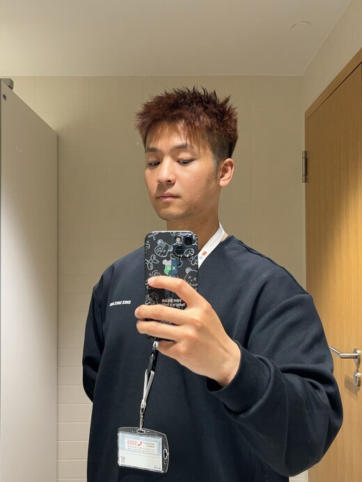

# Hi, I'm Fan Xu

Ph.D. candidate at the **University of Luxembourg**, working on **multimodal machine learning** for representation alignment, image-text retrieval, composed image retrieval, and cultural heritage applications.

I like research questions where vision and language models have to do more than look impressive: retrieve the right evidence, stay robust under noisy inputs, and make their learned spaces interpretable enough to trust.

## What I Work On

- **Multimodal representation learning**: alignment between visual and textual embedding spaces, contrastive learning, and cross-modal retrieval.
- **Composed image retrieval**: query reformulation, pseudo-fusion, diffusion models, and multimodal large language models.
- **Robust multimodal systems**: understanding how visual and textual corruptions affect retrieval behavior.
- **Digital humanities and cultural heritage**: connecting historical posters, newspapers, and collection-scale visual-textual archives.

## Selected Publications

- **Training-Free Pseudo-Fusion for Composed Image Retrieval with Diffusion Models and Multimodal Large Language Models** 
  Fan Xu, Luis A. Leiva. *Transactions on Machine Learning Research*, 2026. 
  [Paper](https://openreview.net/forum?id=6W3pFEQXZc) · [Code](https://github.com/StevenXuf/PeFuse4CIR)

- **Match Me if You Can: Aligning Historical Posters and Newspaper Articles via Multimodal Deep Learning** 
  Fan Xu, Marten During, Luis A. Leiva. *Digital Scholarship in the Humanities*, 2026. 
  [Paper](https://doi.org/10.1093/llc/fqag088) · [Code](https://github.com/StevenXuf/MatchMeIfYouCan)

- **Multimodal Representation Alignment for Cross-modal Information Retrieval** 
  Fan Xu, Luis A. Leiva. 2025. 
  [arXiv](https://arxiv.org/abs/2506.08774) · [Code](https://github.com/StevenXuf/Cross-modal-Feature-Alignment)

## Current Academic Life

- Ph.D. candidate in Multimodal Machine Learning, Department of Computer Science, University of Luxembourg.
- Teaching assistant for **Human-Computer Interaction**.
- Reviewer for venues including **SIGIR**, **CIKM**, **ECIR**, **ICLR**, and **WWW**.
- Recent research visits and schools include the University of Trento, University of Amsterdam, Aalto University, and University of Cambridge.

## Background

- **University of Luxembourg**: Ph.D. candidate in Multimodal Machine Learning, 2023-present.
- **Technical University of Munich**: M.Sc. in Mathematics in Data Science.
- **Northwest University**: B.Sc. in Financial Mathematics and Statistics; B.A. minor in Japanese Language and Literature.

## Toolbox

## Languages

Chinese (native) · English (C2) · German (B1) · Japanese (N2)

---

I am always happy to hear from people working on multimodal learning, retrieval, robustness, or computational approaches to cultural collections.
